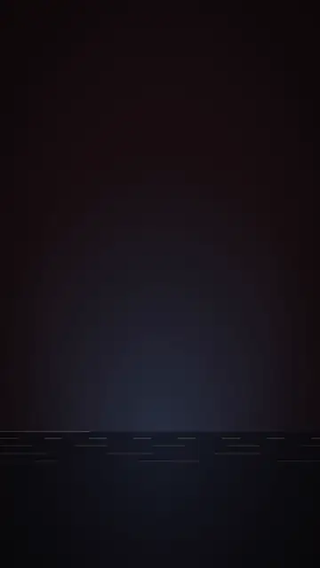
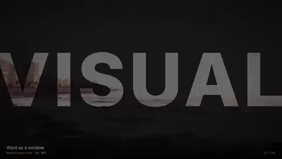
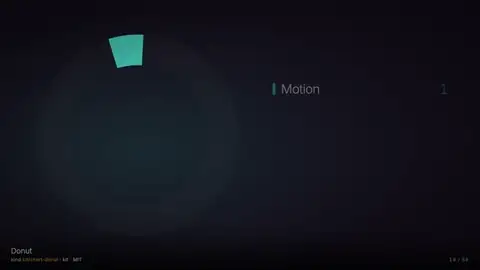

<p align="center">
  <b>CONNECT AI LAB</b> · 모두를 위한 AI 교육 · AI education for everyone<br>
  <a href="https://www.youtube.com/@CONNECT-AI-LAB">YouTube: CONNECT AI LAB</a> · <a href="https://www.aicitybuilders.com/vibecoding">강의: 비주얼 바이브코딩</a> · <a href="README.md">English</a>
</p>

# connect-ai-motion

**나의 AI 모션그래픽 직원. 글 몇 줄을 주면 완성된 모션그래픽 영상이 나옵니다. 찍은 영상은 없어도 됩니다.**

CONNECT AI LAB 이 만든 오픈소스, [비주얼 바이브코딩](https://www.aicitybuilders.com/vibecoding) 3강의 도구입니다. 커머스 콘텐츠와 지식 콘텐츠에 씁니다: 가게 홍보, 강의 광고, 채널 소개, 설명 영상. 하고 싶은 말은 있는데 찍어 둔 영상이 없을 때.

[](docs/index.html)

## 시작

명령 한 줄입니다. 내 코딩 에이전트(Claude Code, Codex, Antigravity, Cursor)에 스킬을 넣습니다.

```bash
npx connect-ai-motion install-skill
```

그다음 에이전트에서 새 대화를 열고 "이 대본으로 모션그래픽 영상 만들어 줘" 라고 말하세요. 대본(몇 줄, 한국어도 됩니다)과 넣고 싶은 그림이 있으면 같이 주세요. 에이전트가 스토리보드를 짜고, 검사하고, `out/film.mp4`(쇼츠용 9:16 도)를 렌더하고, 검사 결과를 알려 줍니다.

Node.js 18 이상이 필요합니다. 처음 실행할 때 패키지를 내려받고(npm 이 "Ok to proceed?" 를 물으면 y), 첫 렌더 때 Remotion 이 쓰는 브라우저를 한 번 내려받습니다.

## 보여 주기

이 영상들에는 카메라 화면이 한 장도 없습니다. 전부 장면마다 한 줄인 스토리보드이고, 화면의 글자는 대본의 낱말입니다.

<table>
<tr>
<td width="27%" valign="top"><br><b>촬영 없이 만든 강의 광고</b><br><sub>글 열 줄과 강의 페이지 스크린샷 두 장. 28초, 16:9 와 9:16. <a href="docs/demo/course_ad_9x16.mp4">mp4</a></sub></td>
<td width="27%" valign="top"><br><b>한국어 가게 홍보, 브랜드 색</b><br><sub>예시로 지어낸 빵집의 한국어 여섯 줄. 내 컴퓨터에서 <code>demo --ko</code> 로 만들어집니다. <a href="docs/demo/shop_ko_9x16.mp4">mp4</a></sub></td>
<td width="46%" valign="top"><br><b>촬영본 없이 강의 한 대목</b><br><sub>만든 사람의 실제 강의 목소리. 박자마다 그 말을 하는 순간에 시작합니다. 박자 20개 중 그림 17개. <a href="docs/demo/flagship.mp4">소리 있는 mp4</a></sub></td>
</tr>
</table>

### 한 줄로 부르는 장면

장면 대부분은 글자 카드가 아니라 그림입니다. 하나하나가 `storyboard.json` 의 한 줄입니다. 예: `{"say": "2D 에서 3D 로", "kind": "kit/flat-to-solid", "from": "2D", "to": "3D"}`

<table>
<tr><td width="25%" valign="top"><br><b>평면에서 입체로</b><br><sub>말하는 순간 평면 도형이 입체가 됩니다.</sub><br><code>kit/flat-to-solid</code></td><td width="25%" valign="top"><br><b>브라우저 속 내 페이지</b><br><sub>내 스크린샷이 창 안에서 스크롤되고 커서가 누릅니다.</sub><br><code>kit/device-browser</code></td><td width="25%" valign="top"><br><b>그려지는 선 그래프</b><br><sub>말에 맞춰 선이 점마다 그려집니다.</sub><br><code>kit/chart-line</code></td><td width="25%" valign="top"><br><b>아이소메트릭 도시</b><br><sub>말한 것마다 도시에서 탑이 올라옵니다.</sub><br><code>kit/iso-city</code></td></tr>
<tr><td width="25%" valign="top"><br><b>사진 두 장, 선 하나</b><br><sub>선이 지나가며 사진이 도면으로 바뀝니다.</sub><br><code>kit/photo-wipe</code></td><td width="25%" valign="top"><br><b>지도 위의 길</b><br><sub>지도 위에 길이 핀마다 그려집니다.</sub><br><code>kit/draw-route</code></td><td width="25%" valign="top"><br><b>내 3D 모델</b><br><sub>내 .glb 가 와이어프레임에서 완성본으로.</sub><br><code>remotion/three-model</code></td><td width="25%" valign="top"><br><b>코드와 결과</b><br><sub>코드의 값 하나가 바뀌면 결과가 따라갑니다.</sub><br><code>kit/code-result</code></td></tr>
<tr><td width="25%" valign="top"><br><b>궤도</b><br><sub>말한 것들이 가운데를 돕니다.</sub><br><code>kit/orbit</code></td><td width="25%" valign="top"><br><b>낱말 창</b><br><sub>낱말이 창이 되어 내 사진으로 열립니다.</sub><br><code>kit/type-mask</code></td><td width="25%" valign="top"><br><b>도넛 차트</b><br><sub>말한 숫자만큼 조각이 자랍니다.</sub><br><code>kit/chart-donut</code></td><td width="25%" valign="top"><br><b>픽셀 게임</b><br><sub>코드로 그린 작은 게임 세상.</sub><br><code>kit/pixel-run</code></td></tr>
</table>

전체 <!--n-->83<!--/n-->개(장면 66, 배경 10, 전환 7)는 [카탈로그 페이지](docs/index.html)에서 움직이는 클립으로 볼 수 있습니다.

## 에이전트 없이

```bash
npx connect-ai-motion demo          # 내장 예제, 처음부터 끝까지
npx connect-ai-motion demo --ko     # 한국어 예제, 16:9 와 9:16
npx connect-ai-motion my-script.md  # 내 대본, 한 줄에 장면 하나
```

## 내 브랜드

기본 룩은 검정과 골드에 주제 색을 더한 것입니다. 내 색과 폰트는 `storyboard.json` 에 넣습니다.

```json
{"colors": {"accent": "#E4572E", "bg": "#101014", "ink": "#F5F0E6"}, "font": "input/MyFont.ttf"}
```

색은 어디서든 고르면 됩니다(예: Adobe Color). 폰트는 써도 되는 파일로(Google Fonts 에서 Get font, Download. 대부분 SIL Open Font License). 한국어, 일본어도 화면에 나옵니다. 폰트 파일이 없으면 컴퓨터에 있는 폰트로 그립니다.

## 무엇인가

대본의 한 줄이 박자 하나이고, 박자 하나가 화면 가득한 장면 하나입니다. 장면은 우리 것만이 아닙니다. Remotion 패키지, HyperFrames 블록, Lottie 파일, GPU 셰이더, 내가 만든 컴포넌트가 한 카탈로그에 들어가 같은 방법으로 불리고, 그 위의 한 층이 박자를 맞추고 리듬을 검사합니다.

종합격투기가 여러 무술의 좋은 기술을 한 경기장에서 쓰게 했듯이, 이 키트는 그래픽 라이브러리를 하나 더 만들지 않습니다. 이미 있는 것들을 이어서, 어느 것이든 `storyboard.json` 의 한 줄로 부릅니다.

```json
{"say": "No footage. Only a script. A finished film.", "kind": "remotion/kinetic-lines", "lines": ["No footage", "Only a script", "A finished film"]}
{"say": "Something new every three seconds.",          "kind": "hyperframes/ring-count", "value": "3", "unit": "seconds"}
{"say": "It checks itself before it renders.",         "kind": "lottie/gold-check", "text": "Check"}
{"say": "This is my own picture.",                     "kind": "custom", "component": "./scenes/Mine.tsx"}
```

> **라이선스.** 이 키트는 MIT 입니다. 바탕인 [Remotion](https://www.remotion.dev) 은 MIT 가 아닙니다. 개인, 직원 3명 이하 회사, 비영리는 무료이고 그 밖의 회사는 Remotion Company License 가 필요합니다([LICENSE.md](https://github.com/remotion-dev/remotion/blob/main/LICENSE.md)). 카탈로그 일부는 같은 Remotion License 의 패키지를 쓰고, HyperFrames 블록은 Apache-2.0, GSAP 은 GreenSock 의 무료 표준 라이선스(OSI 라이선스는 아님)입니다. 항목마다 `meta.json` 에 라이선스가 적혀 있고, 허용 목록에 없는 라이선스는 카탈로그가 받지 않습니다. 전체 목록은 [NOTICE.md](NOTICE.md).


## 어떻게 돌아가나

1. **박자.** `draft` 가 대본 한 줄을 박자 하나로 만들고, 줄의 성격(숫자, 단계, 대비, 인용)에 맞는 장면을 고릅니다. 줄에 있는 낱말만 가져옵니다. 그다음 내가(또는 에이전트가) 고칩니다. 한 줄을 여러 박자로 나누거나 여러 줄을 한 박자에 묶어도 됩니다.
2. **시간.** 목소리가 없으면 그 줄을 읽는 데 걸리는 시간만큼(C 등급). 목소리와 자막이 있으면 자막 낱말에 맞춰(B 등급, 약 ±0.2초), 낱말 시간이 있으면 그 낱말에 맞춰(A 등급) 시작합니다. 장면 안의 것(목록 항목, 값이 바뀌는 순간)도 낱말에 맞출 수 있습니다.
3. **두 화면비.** 같은 스토리보드로 16:9 와 9:16 을 만듭니다. 장면마다 세로 전용 배치가 따로 있고, 9:16 에서는 앱의 윗줄 · 버튼 줄 · 자막 자리를 피합니다.
4. **렌더 전 검사.** `check` 가 스토리보드를 까다로운 편집자처럼 읽고, 문제마다 고치는 법을 문장으로 알려 줍니다.
5. **렌더 후 검사.** 만들어진 영상 자체를 보고 빈 구간, 멈춘 화면, 화면을 못 채운 장면을 알려 줍니다.

## check 가 보는 것

| 규칙 | 등급 |
|---|---|
| 화면에 새로운 것이 3초 넘게 없음(카메라 움직임이 아니라 내용) | 오류 |
| 같은 디자인을 한 영상에 두 번 | 오류(박자 25개 이상인 영상은 조언) |
| 대본 줄에 없는 낱말 · 숫자가 화면에 있음, 차트 값 포함(조사 · 단위는 압니다: "7시에" 는 "7시" 를 덮고, "115명" 은 "15명" 을 덮지 않습니다) | 오류 |
| 그 장면이 읽기 좋은 낱말 수를 넘음 | 오류 |
| 읽기에 너무 짧게 떠 있음 | 오류 |
| 없는 장면 · 배경 · 전환, 여기서 재생 못 하는 것, 잘못된 자리에 쓴 것(가까운 이름을 알려 줌) | 오류 |
| 빠진 필드, 없는 파일 | 오류 |
| 0.6초 넘게 빈 화면(측정) | 오류 |
| 글자만으로 가는 장면이 연달아 3번 이상(이름을 쓰지 말고 그것을 보여 주세요: `catalog --lead picture`) | 조언 |
| 컷의 40 % 넘게 전환, 같은 전환 두 번 | 조언 |
| 1.6초 동안 완전히 멈춘 화면(측정) | 조언 |
| 가장 찼을 때도 화면의 2 % 미만(측정) | 조언 |

대본의 "three" 는 화면의 "3" 과 같다고 봅니다. 목소리가 한국어이고 화면이 영어라면 `say` 에는 영어 줄(내 자막 번역)을 적고, 낱말 파일은 한국어 자막을 둡니다. 시간은 실제로 한 말을 따르고, 화면 글자는 `say` 를 따릅니다. 두 말의 뜻이 같은지는 사람이 봅니다.

## 카탈로그

`npx connect-ai-motion catalog` 로 전부 봅니다. 지금 **재생되는 항목 83개**(장면 66 · 배경 10 · 전환 7), 이유와 함께 목록에만 있는 것 3개.

| 출처 | 그림 장면 | 글자 장면 | 배경 · 전환 | 예 |
|---|---|---|---|---|
| `kit/` | 28 | 10 | 1 | **내 그림:** 움직이는 사진, 두 그림과 선 하나, 레이어로 만든 깊이, 인화지 벽, 필름 스트립, 창이 되는 낱말, 그림 위 렌즈 · **기기:** 브라우저, 폰, 노트북 + 폰(내 스크린샷 · 클립) · **데이터:** 선 그래프, 도넛, 히트맵, 간트, 산점도 · **선 그림:** 지도 위 경로, 스카이라인, 아무 SVG 경로 · **도식:** 노드 그래프, 궤도, 흐름도, 평면에서 입체로, 아이소메트릭 도시, 격자 위 학습 · 코드와 그 결과, 도형 하나 캐릭터, 픽셀 게임, 선과 정거장 · 브랜드 카드, 핵심 낱말, 단계, 전 / 후, 인용, 큰 숫자, 떨어지는 글자, 엔드 카드 · 빛 웅덩이 |
| `remotion/` | 9 | 9 | 3 + 6 + 1 | 턴테이블 위 내 .glb 모델, 3D 공간에 뜬 내 스틸, 3D 입체(three), 판 쌓기(svg-3d-engine), 흐름(paths), 막대 · 퍼센트 링(shapes), 코드 한 줄 바꾸기(prismjs), 프롬프트와 클릭(mac-cursors) · 압출 3D 글자(three), 헤드라인, 키네틱 줄, 손으로 표시한 문장, 말에 맞춘 낱말, 수식(KaTeX), 묻고 답하기, 잔상 낱말, 가운데서 펼쳐지는 글자 · 등고선 · 숨 쉬는 점, 느린 광선 · 페이드, 밀기, 와이프, 뒤집기, 시계 와이프, 아이리스 · 컷 위 빛샘 |
| `hyperframes/` | | 7 | | warm-grain 템플릿의 제목 카드 · 원 숫자 · 알약 숫자 · 도형 라벨(원본 그대로), 스크램블 제목 · 낱말 오르기 · 링 카운터(HyperFrames 형식으로 쓴 우리 블록) |
| `lottie/` | | 3 | | 체크, 신호, 궤도 호(아래에 낱말) |
| `shader/` | | | 6 | 흐르는 그라디언트, 빛줄기, 빛의 장막, 스튜디오 벽, 액체 색, 검은 돌(`shaders` 패키지, WebGPU, 프레임에 고정) |

**그림이 먼저입니다.** 장면마다 `meta.json` 에 무엇이 그 장면을 끌고 가는지 적혀 있습니다: `"lead": "picture"`(물체 · 선 그림 · 그래프 · 기기 · 사진 · 3D) 또는 `"lead": "type"`(글자가 곧 그림). 장면 66개 중 37개가 그림입니다. `catalog --lead picture` 로 그림 장면만 보고, 카탈로그 페이지도 그림부터 보여 주며, check 는 글자 장면이 연달아 3번 나오면 알려 줍니다.

**내 그림.** "영상 없이"는 촬영본이 없어도 된다는 뜻이지 아무것도 보여 줄 수 없다는 뜻이 아닙니다. 파일을 보여 주는 장면은 그 필드를 `"media"` 에 적어 두고, 경로는 내 프로젝트 폴더에서 찾습니다:

```json
{"say": "This is the page.",        "kind": "kit/device-browser", "src": "input/my-page.png", "page": true, "text": "The page"}
{"say": "Reality and virtual mix.", "kind": "kit/photo-wipe", "src": "input/room.jpg", "wire": true, "label": "Reality", "label2": "Virtual"}
{"say": "Made in Blender.",         "kind": "remotion/three-model", "src": "input/robot.glb", "wire": true, "text": "Blender"}
```

예제가 쓰는 작은 파일은 `examples/media/` 에 있고(CC0 Poly Haven 파노라마에서 잘라 낸 사진, CC0 모델, 우리 스틸; 그 폴더의 CREDITS.md), `kit:examples/media/photo-1.jpg` 처럼 부릅니다.

항목 하나 = `catalog/<출처>/<이름>/` 폴더 + `meta.json`. `role` 은 scene · bg · transition · sweep, `lead` 는 picture · type, `media` 는 내 파일이 들어가는 필드 목록, `changes` 는 장면이 스스로 새것을 내놓는 때(리듬 검사가 읽음), `family` 는 "디자인은 한 번씩"의 단위, `status` 는 `ok` · `unsupported` · `needs-download`(이유와 함께)입니다.

목록에만 있는 것: HyperFrames 레지스트리 전체(456개, 내려받기 필요. 받은 뒤 `hf-import` 가 블록마다 장면으로 바꾸고 안 되는 것은 이유를 적음), Remocn 컴포넌트와 remotion-bits(내 프로젝트에 깔고 custom 장면으로 부름).

## 내 장면

장면은 카탈로그 항목과 같은 props 를 받는 React 컴포넌트입니다. 글자는 안전 상자 `r` 안에, 그림은 화면 전체를 써도 됩니다.

```tsx
import React from 'react';
import {Box, SceneProps, Words, fit, k01, type} from 'connect-ai-motion/ui';

const Mine: React.FC<SceneProps> = ({it, r, lf, st, ink}) => {
  const fs = fit(String(it.text), r[2] * 0.9, r[3] * 0.4, st.weight, st.tracking);
  return (
    <Box r={r}>
      <div style={{position: 'absolute', left: 0, top: r[3] * 0.3, ...type(st, fs, ink), opacity: k01(lf, 0, 12)}}>
        <Words text={String(it.text)} lf={lf} />
      </div>
    </Box>
  );
};
export default Mine;
```

```json
{"say": "This is mine.", "kind": "custom", "component": "./scenes/Mine.tsx", "text": "Mine", "meta": {"family": "mine", "changes": [0, 0.4]}}
```

`lf` 는 그 박자의 컷부터 센 프레임, `dur` 는 다음 컷까지의 프레임, `st` 는 스타일, `u` 는 배율(짧은 변 1080 px = 1), `tall` 은 9:16 일 때 참입니다. 모든 것이 프레임의 함수여야 합니다(시계, `Math.random()` 금지).

같은 props 로 [connect-ai-video-motion](https://github.com/wonseokjung/connect-ai-video-motion)(2강: 내가 말하는 영상 위에 모션그래픽)용으로 쓴 그래픽도 돌아갑니다. 그 밖에 `{"kind": "hyperframes", "src": "./block.html"}`, `{"kind": "lottie", "src": "./anim.json"}`, 다른 도구(Manim, Motion Canvas, Blender, 화면 녹화)로 만든 컷은 `{"kind": "clip", "src": "./made-elsewhere.mp4"}`.

## 내 목소리

`<프로젝트>/input/` 에 `voice.wav` 와 `voice.srt`(또는 `.vtt`, 또는 낱말 시간 `voice.words.json` = `[{"word", "start", "end"}]`)를 같이 넣습니다.

```json
{"id": "swap", "at": {"text": "빨간색으로", "near": 21.0}, "say": "you just swap the code for black to red,",
 "kind": "remotion/code-swap", "code": "const video = {\n  screen: \"black\",\n};", "from": "black", "to": "red",
 "cues": {"swap": {"text": "빨간색으로", "near": 21.0}}}
```

영상 길이는 목소리 길이를 따릅니다. 전환은 컷의 가운데에 놓이므로 전환을 넣어도 컷과 목소리가 밀리지 않습니다. 이 키트는 소리에서 낱말 시간을 만들지 않습니다(로드맵). 자막이나 낱말 시간을 쓰는 도구라면 무엇이든 됩니다.

## 명령

```
npx connect-ai-motion demo                 내장 예제 (--ko: 한국어 예제)
npx connect-ai-motion <script.md>          내 대본: 옆에 <script>-motion/ 을 만들고 전부 실행
npx connect-ai-motion new [폴더]            채워 넣을 빈 프로젝트
npx connect-ai-motion draft <대본> [폴더]
npx connect-ai-motion check [폴더]          --short 9:16 도 검사, --measure out/film.mp4 도 봄
npx connect-ai-motion sheet [폴더]          스틸만: 박자마다 한 장
npx connect-ai-motion run [폴더]            검사, 렌더, 영상 검사   --short  --square  --only <박자>  --seconds 1  --force
npx connect-ai-motion preview [폴더]        Remotion Studio
npx connect-ai-motion catalog              --lead picture  --use chart  --role bg  --props  --json
npx connect-ai-motion gallery [폴더]        카탈로그 자체를 영상으로   --role scene | bg | transition  --source remotion  --sheet  --clips
npx connect-ai-motion hf-import <폴더>      HyperFrames 블록을 장면으로
npx connect-ai-motion doctor
npx connect-ai-motion install-skill        --agent claude | codex | antigravity | cursor   (remove-skill 로 뺌)
```

프로젝트는 폴더 하나입니다: `script.md`, `storyboard.json`, `my-info.json`, `input/`(목소리, 자막, 내 파일), `out/`(영상, 시트, `report.md`). 스타일은 `connect`(검정과 골드), `night`, `paper`.

소리: `"sound": "tones"` 를 넣으면 컷마다 코드로 만든 부드러운 톤이 하나씩 들어갑니다(샘플 없음, 내려받기 없음). 기본은 꺼짐입니다.

## 하지 않는 것

- 촬영, 영상 생성, 이미지 생성을 하지 않습니다. 코드로 그리고, 내가 준 그림 · 클립 · 3D 모델을 틀에 넣어 움직입니다.
- 3D 장면은 WebGL 을 쓰고, 영상 한 편에 한두 번에서 세 번쯤 쓰는 히어로 장면입니다.
- 대본을 대신 쓰지 않고 주장을 더하지 않습니다. 화면에는 그 줄의 낱말만 나오고, check 가 그것을 지킵니다.
- 사람이 말하는 영상 위에 그래픽을 얹는 도구가 아닙니다. 그것은 [connect-ai-video-motion](https://github.com/wonseokjung/connect-ai-video-motion) 입니다. `--only` 로 뽑은 박자 하나를 편집 프로그램에서 그런 영상 사이에 전체 화면 컷으로 넣을 수 있습니다.
- 셰이더 배경은 렌더하는 컴퓨터에 WebGPU 가 있어야 합니다. 없으면 그 층은 비고 기본 배경이 보입니다.
- 첫 렌더에서 Inter 폰트(Google Fonts)와 Remotion 이 쓰는 브라우저를 한 번 내려받습니다.
- `check` 는 스토리보드를 읽습니다. 내 컴포넌트, HyperFrames 블록, 그림 안에 그려진 글자는 읽지 못하니 `out/sheet.jpg` 로 직접 보세요.
- 내 컴포넌트와 HyperFrames 블록은 내 컴퓨터에서 돌아가는 코드입니다. 믿을 수 있는 파일만 쓰세요.
- macOS 에서 시험했습니다. Windows, Linux 도 Node 와 Remotion 이 돌아가는 곳이라 될 것으로 보지만 아직 시험 전입니다. 겪은 일을 이슈로 남겨 주세요.

## 만든 재료

[Remotion](https://github.com/remotion-dev/remotion) 위에 지었습니다. HyperFrames 형식과 템플릿 블록은 [HeyGen](https://github.com/heygen-com/hyperframes)(Apache-2.0), 타이밍 수치는 [motionmaxxing](https://github.com/Tejashmakwana/motionmaxxing)(Apache-2.0), 9:16 앱 영역은 [facecammaxxing](https://github.com/aaksa/facecammaxxing)(MIT), 셰이더 프리셋은 [shaders](https://github.com/shader-effects-inc/shaders)(MIT). 무엇을 어떻게 썼는지는 [NOTICE.md](NOTICE.md) 에 전부 있습니다.

---

<p align="center">
  <b>CONNECT AI LAB</b> · 모두를 위한 AI 교육<br>
  내 AI 에이전트로 이런 도구를 만드는 법: <a href="https://www.aicitybuilders.com/vibecoding"><b>비주얼 바이브코딩</b></a> (aicitybuilders.com)<br>
  새 강의와 도구는 <a href="https://www.youtube.com/@CONNECT-AI-LAB">YouTube: CONNECT AI LAB</a> 에서
</p>

비주얼 바이브코딩은 강의마다 내 AI 에이전트에게 스킬을 하나씩 줍니다. AI 직원을 한 명씩 만드는 셈입니다. 2강: [connect-ai-video-motion](https://github.com/wonseokjung/connect-ai-video-motion)(내 영상 위에 모션그래픽). 3강: 이 도구(찍은 영상 없이 모션그래픽).

MIT · CONNECT AI LAB · English: [README.md](README.md)
