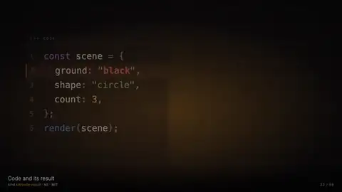

<p align="center"></p>

<p align="center">
  <b>CONNECT AI LAB</b> · 모두를 위한 AI 교육 · AI education for everyone<br>
  <a href="https://www.youtube.com/@CONNECT-AI-LAB">YouTube: CONNECT AI LAB</a> · <a href="https://www.aicitybuilders.com/vibecoding">강의: 비주얼 바이브코딩</a> · <a href="README.md">English</a>
</p>

# connect-ai-motion

**나의 AI 모션그래픽 직원이에요. 글 몇 줄만 주면 완성된 모션그래픽 영상이 나와요. 찍은 영상은 없어도 돼요.**

[](https://wonseokjung.github.io/connect-ai-motion/)

## 시작

```bash
npx connect-ai-motion install-skill
```

그다음에 에이전트(Claude Code, Codex, Antigravity, Cursor)에서 새 대화를 여시고, "이 대본으로 모션그래픽 영상 만들어 줘" 이렇게 한번 말해 보세요.

## 이렇게 나와요

<table>
<tr>
<td width="27%" valign="top"><br><b>촬영 없이 만든 강의 광고</b><br><sub>글 열 줄이랑 스크린샷 두 장. <a href="docs/demo/course_ad_9x16.mp4">mp4</a></sub></td>
<td width="27%" valign="top"><br><b>한국어 가게 홍보</b><br><sub>한국어 여섯 줄. <a href="docs/demo/shop_ko_9x16.mp4">mp4</a></sub></td>
<td width="46%" valign="top"><br><b>촬영본 없이 강의 한 대목</b><br><sub>제 실제 강의 목소리예요. <a href="docs/demo/flagship.mp4">소리 있는 mp4</a></sub></td>
</tr>
</table>

## 한 줄에 장면 하나

<table>
<tr><td width="25%" valign="top"><br><b>평면에서 입체로</b><br><code>kit/flat-to-solid</code></td><td width="25%" valign="top"><br><b>브라우저 속 내 페이지</b><br><code>kit/device-browser</code></td><td width="25%" valign="top"><br><b>그려지는 선 그래프</b><br><code>kit/chart-line</code></td><td width="25%" valign="top"><br><b>아이소메트릭 도시</b><br><code>kit/iso-city</code></td></tr>
<tr><td width="25%" valign="top"><br><b>사진 두 장, 선 하나</b><br><code>kit/photo-wipe</code></td><td width="25%" valign="top"><br><b>지도 위의 길</b><br><code>kit/draw-route</code></td><td width="25%" valign="top"><br><b>내 3D 모델</b><br><code>remotion/three-model</code></td><td width="25%" valign="top"><br><b>코드와 결과</b><br><code>kit/code-result</code></td></tr>
<tr><td width="25%" valign="top"><br><b>궤도</b><br><code>kit/orbit</code></td><td width="25%" valign="top"><br><b>창이 되는 낱말</b><br><code>kit/type-mask</code></td><td width="25%" valign="top"><br><b>도넛 차트</b><br><code>kit/chart-donut</code></td><td width="25%" valign="top"><br><b>픽셀 게임</b><br><code>kit/pixel-run</code></td></tr>
</table>

전부 <!--n-->83<!--/n-->개(장면 66, 배경 10, 전환 7)는 [카탈로그 페이지](https://wonseokjung.github.io/connect-ai-motion/)에서 움직이는 걸로 보실 수 있어요.

## 에이전트 없이

```bash
npx connect-ai-motion demo          # 내장 예제를 처음부터 끝까지
npx connect-ai-motion demo --ko     # 한국어 예제, 16:9 와 9:16
npx connect-ai-motion my-script.md  # 내 대본으로, 한 줄에 장면 하나
```

## 내 브랜드

내 색이랑 폰트는 `storyboard.json`에 이렇게 넣으시면 돼요.

```json
{"colors": {"accent": "#E4572E", "bg": "#101014", "ink": "#F5F0E6"}, "font": "input/MyFont.ttf"}
```

---

명령이랑 옵션은 [docs/guide.ko.md](docs/guide.ko.md)에 다 정리해 뒀어요.

MIT예요. 다만 바탕이 되는 [Remotion](https://www.remotion.dev)은 라이선스가 따로 있어요. 개인, 직원 3명 이하 회사, 비영리는 무료고, 그 밖의 회사는 Remotion Company License가 필요해요. 자세한 건 [NOTICE.md](NOTICE.md)에 있어요.

이런 도구를 내 AI 에이전트로 직접 만드는 법은 [비주얼 바이브코딩](https://www.aicitybuilders.com/vibecoding)에서 알려 드려요.

<table><tr>
<td width="140" valign="top"></td>
<td valign="top"><b>만든 사람: AI 멘토 제이</b> · CONNECT AI LAB<br>
이런 AI 직원을 하나씩 오픈소스로 만들고 있어요. 만드는 법은 유튜브랑 강의에서 보여 드려요.<br>
<a href="https://www.youtube.com/@CONNECT-AI-LAB">유튜브</a> · <a href="https://www.aicitybuilders.com/vibecoding">비주얼 바이브코딩</a> · <a href="https://github.com/wonseokjung">다른 오픈소스</a></td>
</tr></table>

<!-- team:start -->
## CONNECT AI LAB의 AI 직원들

AI 직원을 하나씩 오픈소스로 만들고 있어요. 필요한 직원부터 데려가 쓰세요.

<table>
<tr><td width="34%" valign="top"><b>AI 사업 해부 직원</b><br><a href="https://github.com/wonseokjung/reversebusiness"><code>reversebusiness</code></a></td><td valign="top">사업 웹사이트 주소 하나 주면 그 사업이 어떻게 돈 버는지 읽어 줘요.</td></tr>
<tr><td width="34%" valign="top"><b>AI 영상 편집 직원</b><br><a href="https://github.com/wonseokjung/connect-ai-video-motion"><code>connect-ai-video-motion</code></a></td><td valign="top">내 영상을 주면 몸을 피해서 빈자리에 모션그래픽을 넣어 줘요.</td></tr>
<tr><td width="34%" valign="top"><b>AI 모션그래픽 직원</b> · <b>지금 보는 직원</b><br><a href="https://github.com/wonseokjung/connect-ai-motion"><code>connect-ai-motion</code></a></td><td valign="top">글 몇 줄 주면 모션그래픽 영상을 만들어 줘요. 찍은 영상은 없어도 돼요.</td></tr>
<tr><td width="34%" valign="top"><b>AI 마케터 직원</b><br><a href="https://github.com/wonseokjung/connect-ai-marketer"><code>connect-ai-marketer</code></a></td><td valign="top">내 브라우저에서 24시간 댓글, 리스닝, 업로드를 맡아요.</td></tr>
<tr><td width="34%" valign="top"><b>AI 글쓰기 직원</b><br><a href="https://github.com/wonseokjung/connect-ai-writer"><code>connect-ai-writer</code></a></td><td valign="top">영상 하나 주면 플랫폼마다 내 말투로 글을 쓰고 사진까지 같이 만들어 줘요.</td></tr>
</table>
<!-- team:end -->
