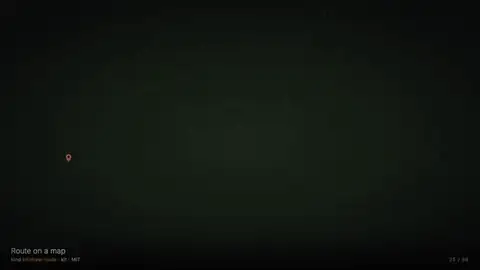
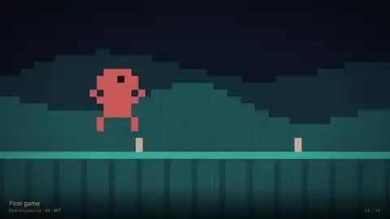
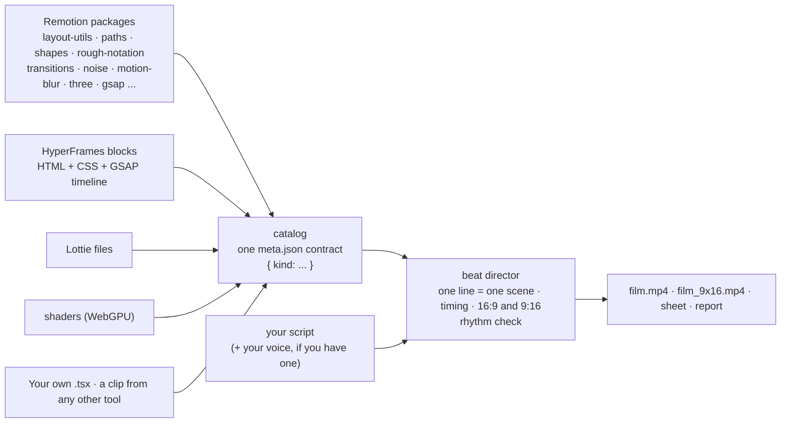

<p align="center">
  <b>CONNECT AI LAB</b> · AI education for everyone · 모두를 위한 AI 교육<br>
  <a href="https://www.youtube.com/@CONNECT-AI-LAB">YouTube: CONNECT AI LAB</a> · <a href="https://www.aicitybuilders.com/vibecoding">Course: Visual Vibe Coding</a> · <a href="README.ko.md">한국어</a>
</p>

# connect-ai-motion

**Your AI motion graphics employee. Turn a few lines of text into a finished motion graphics video. No footage needed.**

Open source by CONNECT AI LAB, the tool of lesson 3 of the [Visual Vibe Coding](https://www.aicitybuilders.com/vibecoding) course. For commerce and knowledge content: a shop promo, a course ad, a channel intro, an explainer, when you have something to say but nothing filmed.

[](docs/index.html)

## Start

Run one command to give your coding agent (Claude Code, Codex, Antigravity, Cursor) the skill:

```bash
npx connect-ai-motion install-skill
```

Then open a new chat with your agent and say "make a motion graphics video from this script", along with your script (a few lines, any language) and any images you want to include. The agent drafts the storyboard, checks it, renders `out/film.mp4` (and 9:16 for Shorts) and tells you what the check found.

You need Node.js 18 or newer. The first run downloads the packages (npm asks "Ok to proceed?": answer y), and the first render downloads the browser Remotion renders with, once.

## Showcase

No camera picture in any of these. Each one is a storyboard of one line per scene; the words on screen are words of the script.

<table>
<tr>
<td width="27%" valign="top"><br><b>A course ad, no footage</b><br><sub>Ten lines of text and two screenshots of the course page. 28 s, 16:9 and 9:16. <a href="docs/demo/course_ad_9x16.mp4">mp4</a></sub></td>
<td width="27%" valign="top"><br><b>A shop promo in Korean, brand colours</b><br><sub>Six lines of Korean for a made-up bakery. <code>demo --ko</code> makes it on your computer. <a href="docs/demo/shop_ko_9x16.mp4">mp4</a></sub></td>
<td width="46%" valign="top"><br><b>A talk, without the footage</b><br><sub>The author's own lecture voice. Every beat starts on the word he says; 20 beats, 17 of them pictures. <a href="docs/demo/flagship.mp4">mp4 with sound</a></sub></td>
</tr>
</table>

### Scenes you can call with one line

Most scenes are pictures, not text cards. Each one is one line of `storyboard.json`, for example `{"say": "With 2D and 3D,", "kind": "kit/flat-to-solid", "from": "2D", "to": "3D"}`.

<table>
<tr><td width="25%" valign="top"><br><b>Flat to solid</b><br><sub>Flat shapes gain depth on the word.</sub><br><code>kit/flat-to-solid</code></td><td width="25%" valign="top"><br><b>Your page in a browser</b><br><sub>Your screenshot scrolls inside a window, the cursor clicks.</sub><br><code>kit/device-browser</code></td><td width="25%" valign="top"><br><b>Line chart, drawn</b><br><sub>The line draws itself, point by point, on the words.</sub><br><code>kit/chart-line</code></td><td width="25%" valign="top"><br><b>Isometric city</b><br><sub>Towers rise from a city, one per thing you name.</sub><br><code>kit/iso-city</code></td></tr>
<tr><td width="25%" valign="top"><br><b>Two pictures, one line</b><br><sub>A line sweeps the photo into a drawing.</sub><br><code>kit/photo-wipe</code></td><td width="25%" valign="top"><br><b>Route on a map</b><br><sub>A route draws across a map, pin by pin.</sub><br><code>kit/draw-route</code></td><td width="25%" valign="top"><br><b>Your 3D model</b><br><sub>Your .glb turns from wireframe to finished.</sub><br><code>remotion/three-model</code></td><td width="25%" valign="top"><br><b>Code and its result</b><br><sub>One value in the code changes, the result follows.</sub><br><code>kit/code-result</code></td></tr>
<tr><td width="25%" valign="top"><br><b>Orbit</b><br><sub>The things you name circle the one in the middle.</sub><br><code>kit/orbit</code></td><td width="25%" valign="top"><br><b>Word as a window</b><br><sub>A word opens like a window onto your picture.</sub><br><code>kit/type-mask</code></td><td width="25%" valign="top"><br><b>Donut</b><br><sub>Slices grow to the numbers you say.</sub><br><code>kit/chart-donut</code></td><td width="25%" valign="top"><br><b>Pixel game</b><br><sub>A small game world, drawn in code.</sub><br><code>kit/pixel-run</code></td></tr>
</table>

All <!--n-->83<!--/n--> items (66 scenes, 10 backgrounds, 7 transitions) are on the [catalog page](docs/index.html) as living clips.

## Without an agent

```bash
npx connect-ai-motion demo          # the built-in example, start to finish
npx connect-ai-motion demo --ko     # the Korean example, 16:9 and 9:16
npx connect-ai-motion my-script.md  # your script, one line per scene
```

## Your brand

The look is black and gold with subject colours. Your own colours and font go in `storyboard.json`:

```json
{"colors": {"accent": "#E4572E", "bg": "#101014", "ink": "#F5F0E6"}, "font": "input/MyFont.ttf"}
```

Pick colours anywhere (Adobe Color, for example) and a font file you may use (Google Fonts: Get font, Download; most are under the SIL Open Font License). Korean, Japanese and other scripts work on screen; without a font file the computer's own fonts draw them.

## What it is

One line of your script is one beat, and one beat is one full-frame scene. Most scenes are pictures, not text cards: a chart that draws itself, a line drawing, a 3D model, your screenshot inside a device, a still photo that moves, a flow chart, an isometric city. The scenes are not ours alone: Remotion packages, HyperFrames blocks, Lottie files, GPU shaders and your own components all sit in one catalog and are called the same way, and one layer on top directs the beats and checks the rhythm.



Like mixed martial arts took the best moves of every style and made them work in one ring, this kit does not add one more graphics library. It connects the ones that exist, so any of them is one line in `storyboard.json`:

```json
{"say": "With 2D, 3D,",                        "kind": "kit/flat-to-solid", "from": "2D", "to": "3D"}
{"say": "Write the script, check, render.",    "kind": "kit/draw-route", "items": ["Script", "Check", "Render"]}
{"say": "the product detail pages you make,",  "kind": "kit/device-browser", "src": "input/page.png", "text": "Product detail pages"}
{"say": "Something new every three seconds.",  "kind": "hyperframes/ring-count", "value": "3", "unit": "seconds"}
{"say": "It checks itself before it renders.", "kind": "lottie/gold-check", "text": "Check"}
{"say": "This is my own picture.",             "kind": "custom", "component": "./scenes/Mine.tsx"}
```

> **Licences.** This kit is MIT. It runs on [Remotion](https://www.remotion.dev), which is not MIT: Remotion is free for individuals, for companies with up to 3 employees and for non-profits; other companies need a Remotion Company License ([LICENSE.md](https://github.com/remotion-dev/remotion/blob/main/LICENSE.md)). Some catalog items use Remotion packages under the same Remotion License, HyperFrames blocks are Apache-2.0, GSAP uses GreenSock's standard no-charge license (not an OSI licence). Each item says its licence in its `meta.json`; the catalog refuses anything that is not on its allow list. The full list is in [NOTICE.md](NOTICE.md).


## How it works

1. **Beats.** `draft` turns each line of your script into a beat and picks a scene by what the line is: a number, steps, a contrast, a quote. It only copies words out of the line. Then you (or your agent) improve it. A line can be split into several beats, and several lines can share one.
2. **Time.** Without a voice, a beat lasts as long as its line takes to read (tier C). With your voice and subtitles next to it, a beat starts on a subtitle word (tier B: words spread over each subtitle line by length, so put a beat on a word with `at` where it matters); with word times, on the word itself (tier A). Things inside a scene (list items, the moment a value changes) can land on words too.
3. **Two shapes.** The same storyboard renders in 16:9 and 9:16. Every scene has its own tall layout, and in 9:16 the words stay out of the app's top bar, button rail and caption area.
4. **Check before render.** `check` reads the storyboard like a picky editor and writes every problem as a sentence that says how to fix it.
5. **Check after render.** The kit looks at the rendered film itself and reports blank stretches, a picture that stands still, and scenes that leave the frame empty.

## What check looks for

| Rule | Grade |
|---|---|
| Nothing new on screen for more than 3 s (the picture's content, not a camera move) | error |
| The same design twice in one film | error (advice in films of 25 beats or more) |
| A word or number on screen that the script line does not say, a chart value included (Korean particles and counters are understood: "7시에" covers "7시", "115명" does not cover "15명") | error |
| More words than the scene reads well | error |
| On screen too short to read | error |
| A scene, background or transition that does not exist, cannot play here, or is used in the wrong place (it names the closest ones) | error |
| A missing field, a missing file | error |
| An empty picture for more than 0.6 s (measured) | error |
| Three scenes in a row that are carried by words only (show the thing instead: `catalog --lead picture`) | advice |
| Transitions on more than 40 % of the cuts, the same transition twice | advice |
| A picture that stands completely still for 1.6 s (measured) | advice |
| A scene that covers under 2 % of the frame at its fullest (measured) | advice |

"Three" in the script covers "3" on screen. If your voice is Korean and the screen is English, `say` is the English line (your subtitle translation, for example) and the words file is the Korean one: the timing follows what is spoken, the words on screen follow `say`. Whether the two mean the same is for a person to judge.

## The catalog

`npx connect-ai-motion catalog` lists everything. Today: **83 items you can play** (66 scenes, 10 backgrounds, 7 transitions) and 3 listed with the reason they cannot (yet).

| Source | Picture scenes | Word scenes | Backgrounds, transitions | Examples |
|---|---|---|---|---|
| `kit/` | 28 | 10 | 1 | **your pictures:** photo that moves, two pictures and a line, depth from layers, wall of prints, film strip, word as a window, lens on a picture · **devices:** browser, phone, laptop + phone with your screenshot or clip · **data:** line chart, donut, heat map, Gantt, scatter · **line drawings:** route on a map, skyline, any SVG path · **diagrams:** node graph, orbit, flow chart, flat to solid, isometric city, learning on a grid · code and its result, one-shape character, pixel game, line with stops · brand card, key word, steps, before / after, quote, big number, letters that fall, end card; light pool |
| `remotion/` | 9 | 9 | 3 + 6 + 1 | your .glb model on a turntable, your stills as panels in 3D space, 3D solid (three), stack of plates (svg-3d-engine), flow (paths), bars and percent ring (shapes), change one line of code (prismjs), prompt and click (mac-cursors) · extruded 3D words (three), headline, kinetic lines, marked sentence (rough-notation), words in time (captions), formula (KaTeX), ask and answer, word with a trail (motion-blur), letters from the middle (gsap); contour lines and breathing dots (noise), slow rays (starburst); fade, push, wipe, flip, clock wipe, iris; light leak over the cut |
| `hyperframes/` | | 7 | | title card, circle stat, pill stat, shape label from the warm-grain template (unchanged copies); scramble title, words rise, ring counter (our blocks in the HyperFrames format) |
| `lottie/` | | 3 | | check mark, signal pulse, orbit arcs, each with a word under it |
| `shader/` | | | 6 | flowing gradient, god rays, curtains of light, studio wall, liquid colour, dark stone (the `shaders` package, WebGPU, locked to the frame) |

**Pictures first.** Every scene says in its `meta.json` what carries it: `"lead": "picture"` (an object, a drawing, a chart, a device, a photo, 3D) or `"lead": "type"` (the words are the picture). 37 of the 66 scenes are pictures. `catalog --lead picture` lists them, the catalog page shows them first, and check points at three word scenes in a row.

**Your pictures.** "No footage" means you do not need to film, not that you may not show anything. A scene that shows a file lists the field in `"media"`, and the path is looked up from your project folder:

```json
{"say": "This is the page.",        "kind": "kit/device-browser", "src": "input/my-page.png", "page": true, "text": "The page"}
{"say": "Reality and virtual mix.", "kind": "kit/photo-wipe", "src": "input/room.jpg", "wire": true, "label": "Reality", "label2": "Virtual"}
{"say": "Made in Blender.",         "kind": "remotion/three-model", "src": "input/robot.glb", "wire": true, "text": "Blender"}
```

The small files the examples use are in `examples/media/` (photos cut from CC0 Poly Haven panoramas, a CC0 model, our own stills; see its CREDITS.md) and are called as `kit:examples/media/photo-1.jpg`.

Each item is a folder `catalog/<source>/<name>/` with the component (or `block.html` / `anim.json`) and a `meta.json`:

```json
{
  "kind": "remotion/rough-mark",
  "title": "Marked sentence",
  "source": {"type": "remotion", "package": "@remotion/rough-notation", "version": "4.0.529"},
  "license": "MIT",
  "role": "scene",
  "use": "emphasis",
  "lead": "type",
  "props": {"text": "the sentence", "hi": "the phrase to mark", "mark": "highlight | circle | underline"},
  "needs": ["text", "hi"],
  "changes": [0, 0.4],
  "maxWords": 14,
  "family": "rough-mark",
  "example": {"text": "You only change one line", "hi": "one line"}
}
```

`role` is scene, bg, transition or sweep. `lead` is picture or type. `media` lists the fields that hold your files. `changes` tells the rhythm check when the scene itself brings something new. `family` is what "each design once" counts. `status` is `ok`, `unsupported` or `needs-download`, with `reasons`.

Listed but not playable here: the full HyperFrames registry (456 items, a download; `hf-import` then turns each block into a scene and lists the ones that cannot play frame by frame), Remocn components and remotion-bits parts (install them in your project and call them as custom scenes).

## Your own scene

A scene is a React component that receives the same props as every catalog item. Keep words inside the safe box `r`; pictures may use the whole frame.

```tsx
import React from 'react';
import {Box, SceneProps, Words, fit, k01, type} from 'connect-ai-motion/ui';

const Mine: React.FC<SceneProps> = ({it, r, lf, st, ink}) => {
  const fs = fit(String(it.text), r[2] * 0.9, r[3] * 0.4, st.weight, st.tracking);
  return (
    <Box r={r}>
      <div style={{position: 'absolute', left: 0, top: r[3] * 0.3, ...type(st, fs, ink), opacity: k01(lf, 0, 12)}}>
        <Words text={String(it.text)} lf={lf} />
      </div>
    </Box>
  );
};
export default Mine;
```

```json
{"say": "This is mine.", "kind": "custom", "component": "./scenes/Mine.tsx", "text": "Mine", "meta": {"family": "mine", "changes": [0, 0.4]}}
```

`lf` is the frame since the beat's cut, `dur` the frames until the next one, `st` the style, `u` the scale (1 = 1080 px short side), `tall` is true in 9:16. Everything must be a function of the frame: no clocks, no `Math.random()`.

The same props work for a graphic written for [connect-ai-video-motion](https://github.com/wonseokjung/connect-ai-video-motion) (lesson 2: motion graphics on top of your own talking video). Other ways in: `{"kind": "hyperframes", "src": "./block.html"}`, `{"kind": "lottie", "src": "./anim.json"}`, and `{"kind": "clip", "src": "./made-elsewhere.mp4"}` for a shot made with any other tool (Manim, Motion Canvas, Blender, a screen recording).

## Your voice

Put `voice.wav` in `<project>/input/` with `voice.srt` (or `.vtt`, or `voice.words.json` as `[{"word", "start", "end"}]`) next to it.

```json
{"id": "swap", "at": {"text": "red", "near": 20.9}, "say": "you just swap the code for black to red,",
 "kind": "remotion/code-swap", "code": "const video = {\n  screen: \"black\",\n};", "from": "black", "to": "red",
 "cues": {"swap": {"text": "red", "near": 20.9}}}
```

The film is as long as the voice. Transitions sit centred on the cuts, so adding one never moves a cut or the voice. The kit does not make word times from audio (see the roadmap); any tool that writes subtitles or word times works.


## Reference

### Commands

```
npx connect-ai-motion demo                 the built-in example (--ko: the Korean one)
npx connect-ai-motion <script.md>          your script: makes <script>-motion/ next to it and runs everything
npx connect-ai-motion new [folder]         an empty project to fill in
npx connect-ai-motion draft <script> [folder]
npx connect-ai-motion check [folder]       --short also checks 9:16, --measure also looks at out/film.mp4
npx connect-ai-motion sheet [folder]       stills only: one per beat
npx connect-ai-motion run [folder]         check, render, check the film   --short  --square  --only <beat>  --seconds 1  --force
npx connect-ai-motion preview [folder]     Remotion Studio with your storyboard
npx connect-ai-motion catalog              --lead picture  --use chart  --role bg  --props  --json
npx connect-ai-motion gallery [folder]     the catalog itself as a film   --role scene | bg | transition  --source remotion  --sheet  --clips
npx connect-ai-motion hf-import <folder>   HyperFrames blocks to scenes
npx connect-ai-motion doctor
npx connect-ai-motion install-skill        --agent claude | codex | antigravity | cursor   (remove-skill takes it out again)
```

A project is a folder: `script.md`, `storyboard.json`, `my-info.json`, `input/` (voice, subtitles, your files), `out/` (film, sheets, `report.md`). Styles: `connect` (black and gold), `night`, `paper`; they are one block each in `src/styles/presets.mjs`.

Sound: `"sound": "tones"` adds one soft code-made tone per cut (no samples, nothing downloaded). It is off by default.

### Where it stops

- It does not film, generate footage or generate images. It draws with code and frames the pictures, clips and 3D models you give it.
- It does not write your script and it does not add claims: the screen shows words of the line, and check enforces that.
- It is not for graphics on top of a person talking: that is [connect-ai-video-motion](https://github.com/wonseokjung/connect-ai-video-motion). A beat rendered with `--only` can be cut into such a video as a full-frame insert in any editor.
- 3D scenes use WebGL and are for one to three moments in a film, not every beat.
- Shader backgrounds need WebGPU on the computer that renders. Without it the layer stays empty and the plain background shows.
- The first render downloads the Inter font (Google Fonts) and, once, the browser Remotion renders with.
- `check` reads the storyboard. It cannot read words drawn inside your own components, HyperFrames blocks or pictures: look at `out/sheet.jpg` for those.
- Your own components and HyperFrames blocks are code that runs on your computer. Use files you trust.
- Tested on macOS. Windows and Linux are expected to work (Node and Remotion run there) but are not tested yet; please open an issue with what you see.

## Roadmap

Word times from audio on your computer (whisper.cpp through `@remotion/install-whisper-cpp`, a model download you choose); cuts on the beats of a music track; importing the HyperFrames registry in one step; a stage scene that holds several lesson-2 graphics at once.

## Credits

Built on [Remotion](https://github.com/remotion-dev/remotion). HyperFrames format and template blocks by [HeyGen](https://github.com/heygen-com/hyperframes) (Apache-2.0). Timing numbers from [motionmaxxing](https://github.com/Tejashmakwana/motionmaxxing) (Apache-2.0). 9:16 app zones from [facecammaxxing](https://github.com/aaksa/facecammaxxing) (MIT). Shader presets by the [shaders](https://github.com/shader-effects-inc/shaders) package (MIT). Everything that was used, and how, is in [NOTICE.md](NOTICE.md).

---

<p align="center">
  <b>CONNECT AI LAB</b> · AI education for everyone<br>
  Learn to build tools like this with your own AI agent: <a href="https://www.aicitybuilders.com/vibecoding"><b>Visual Vibe Coding</b></a> at aicitybuilders.com<br>
  New lessons and tools on <a href="https://www.youtube.com/@CONNECT-AI-LAB">YouTube: CONNECT AI LAB</a>
</p>

Each lesson of the course gives your AI agent one new skill, one AI employee at a time. Lesson 2: [connect-ai-video-motion](https://github.com/wonseokjung/connect-ai-video-motion) (motion graphics on top of your own video). Lesson 3: this one (motion graphics with no footage).

MIT · CONNECT AI LAB · 한국어: [README.ko.md](README.ko.md)
