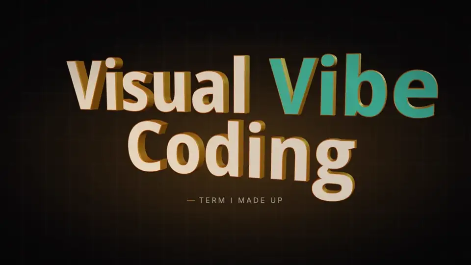

<p align="center"></p>

<p align="center">
  <b>CONNECT AI LAB</b> · AI education for everyone · 모두를 위한 AI 교육<br>
  <a href="https://www.youtube.com/@CONNECT-AI-LAB">YouTube: CONNECT AI LAB</a> · <a href="https://www.aicitybuilders.com/vibecoding">Course: Visual Vibe Coding</a> · <a href="README.ko.md">한국어</a>
</p>

# connect-ai-motion

**Your AI motion graphics automation agent. Turn a few lines of text into a finished motion graphics video. No footage needed.**

[](https://wonseokjung.github.io/connect-ai-motion/)

## Start

```bash
npx connect-ai-motion install-skill
```

Then open a new chat with your agent (Claude Code, Codex, Antigravity, Cursor) and say "make a motion graphics video from this script".

<p align="center">
  &nbsp;
  &nbsp;
  &nbsp;
  <br>
  <sub><b>Dohwaseo Motion Painter</b> (CONNECT AI HQ PixelCrew) — gently animated pixel portrait that switches expression as it greets, storyboards, renders, and finishes your film.</sub>
</p>

## Showcase

<table>
<tr>
<td width="27%" valign="top"><br><b>A course ad, no footage</b><br><sub>Ten lines of text, two screenshots. <a href="docs/demo/course_ad_9x16.mp4">mp4</a></sub></td>
<td width="27%" valign="top"><br><b>A shop promo in Korean</b><br><sub>Six lines of Korean. <a href="docs/demo/shop_ko_9x16.mp4">mp4</a></sub></td>
<td width="46%" valign="top"><br><b>A talk, without the footage</b><br><sub>My own lecture voice. <a href="docs/demo/flagship.mp4">mp4 with sound</a></sub></td>
</tr>
</table>

## One line, one scene

<table>
<tr><td width="25%" valign="top"><br><b>Flat to solid</b><br><code>kit/flat-to-solid</code></td><td width="25%" valign="top"><br><b>Your page in a browser</b><br><code>kit/device-browser</code></td><td width="25%" valign="top"><br><b>Line chart, drawn</b><br><code>kit/chart-line</code></td><td width="25%" valign="top"><br><b>Isometric city</b><br><code>kit/iso-city</code></td></tr>
<tr><td width="25%" valign="top"><br><b>Two pictures, one line</b><br><code>kit/photo-wipe</code></td><td width="25%" valign="top"><br><b>Route on a map</b><br><code>kit/draw-route</code></td><td width="25%" valign="top"><br><b>Your 3D model</b><br><code>remotion/three-model</code></td><td width="25%" valign="top"><br><b>Code and its result</b><br><code>kit/code-result</code></td></tr>
<tr><td width="25%" valign="top"><br><b>Orbit</b><br><code>kit/orbit</code></td><td width="25%" valign="top"><br><b>Word as a window</b><br><code>kit/type-mask</code></td><td width="25%" valign="top"><br><b>Donut</b><br><code>kit/chart-donut</code></td><td width="25%" valign="top"><br><b>Pixel game</b><br><code>kit/pixel-run</code></td></tr>
</table>

All <!--n-->83<!--/n--> items (66 scenes, 10 backgrounds, 7 transitions) are on the [catalog page](https://wonseokjung.github.io/connect-ai-motion/) as moving clips.

## Without an agent

```bash
npx connect-ai-motion demo          # the built-in example, start to finish
npx connect-ai-motion demo --ko     # the Korean example, 16:9 and 9:16
npx connect-ai-motion my-script.md  # your script, one line per scene
```

## Your brand

Put your own colors and font in `storyboard.json`, like this.

```json
{"colors": {"accent": "#E4572E", "bg": "#101014", "ink": "#F5F0E6"}, "font": "input/MyFont.ttf"}
```

---

Every command and option is in [docs/guide.md](docs/guide.md).

This project is MIT. It runs on [Remotion](https://www.remotion.dev), which has its own license. Remotion is free for individuals, non-profits and companies with up to 3 employees; other companies need a Remotion Company License. The details are in [NOTICE.md](NOTICE.md).

If you want to build tools like this with your own AI agent, I show you how in [Visual Vibe Coding](https://www.aicitybuilders.com/vibecoding).

<table><tr>
<td width="140" valign="top"></td>
<td valign="top"><b>Made by AI Mentor Jay</b> · CONNECT AI LAB<br>
I build AI agents like this one in the open, one by one, and show how on YouTube and in my course.<br>
<a href="https://www.youtube.com/@CONNECT-AI-LAB">YouTube</a> · <a href="https://www.aicitybuilders.com/vibecoding">Visual Vibe Coding</a> · <a href="https://github.com/wonseokjung">More open source</a></td>
</tr></table>

<!-- team:start -->
## CONNECT AI LAB's AI Agent Team (14) · ELDO Browser

I build AI agents in the open, one by one. Grab the one you need, or browse and hire all 14 with [ELDO Browser](https://eldobrowser.com) and [`wonseokjung/eldo`](https://github.com/wonseokjung/eldo) (`npx github:wonseokjung/eldo`).

<table>
<tr><td width="34%" valign="top"><b>ELDO Browser · Open-Source Hub</b><br><a href="https://eldobrowser.com"><code>eldobrowser.com</code></a> · <a href="https://github.com/wonseokjung/eldo"><code>eldo</code></a></td><td valign="top">The free Browser for AI Agents (Apple Notarized macOS &amp; Windows). Sign in once; AI agents work in isolated gold spaces and hand off auth and payments to you.</td></tr>
<tr><td width="34%" valign="top"><b>AI autonomous company HQ</b><br><a href="https://github.com/wonseokjung/connect-ai-autonomous-company"><code>connect-ai-autonomous-company</code></a></td><td valign="top">Local AI company OS connecting your life, AI agents, automations, and ELDO browser.</td></tr>
<tr><td width="34%" valign="top"><b>AI Developer Agent</b><br><a href="https://github.com/wonseokjung/connect-ai-developer"><code>connect-ai-developer</code></a></td><td valign="top">One sentence in, a service with sign-up, database, test payments, GitHub and deploy plans out.</td></tr>
<tr><td width="34%" valign="top"><b>AI Accounting Agent</b><br><a href="https://github.com/wonseokjung/connect-ai-accountant"><code>connect-ai-accountant</code></a></td><td valign="top">Receipts, 홈택스, card and bank in. A monthly sheet and a package for your tax accountant out.</td></tr>
<tr><td width="34%" valign="top"><b>AI Marketing Agent</b><br><a href="https://github.com/wonseokjung/connect-ai-marketer"><code>connect-ai-marketer</code></a></td><td valign="top">8 AI teammates handling replies, social listening and YouTube uploads 24/7 in your browser.</td></tr>
<tr><td width="34%" valign="top"><b>AI Writing Agent</b><br><a href="https://github.com/wonseokjung/connect-ai-writer"><code>connect-ai-writer</code></a></td><td valign="top">Give it one video or topic; it researches and writes platform posts in your voice, with pictures.</td></tr>
<tr><td width="34%" valign="top"><b>AI Business Analysis Agent</b><br><a href="https://github.com/wonseokjung/reversebusiness"><code>reversebusiness</code></a></td><td valign="top">Give it a website URL, and it breaks down how that business makes money and designs your version.</td></tr>
<tr><td width="34%" valign="top"><b>AI Image Agent</b><br><a href="https://github.com/wonseokjung/connect-ai-image"><code>connect-ai-image</code></a></td><td valign="top">Free-first local ComfyUI + FLUX or logged-in browser image series for every platform.</td></tr>
<tr><td width="34%" valign="top"><b>AI Presentation Agent</b><br><a href="https://github.com/wonseokjung/connect-ai-slides-web"><code>connect-ai-slides-web</code></a></td><td valign="top">Turn a few lines or an old PPT into a motion-first 3D web deck and a real PowerPoint (.pptx) file.</td></tr>
<tr><td width="34%" valign="top"><b>AI Web 3D Agent</b><br><a href="https://github.com/wonseokjung/connect-ai-three"><code>connect-ai-three</code></a></td><td valign="top">Say it, get an interactive Three.js 3D web page and a frame-exact film from one spec.</td></tr>
<tr><td width="34%" valign="top"><b>AI Motion Graphics Agent</b> · <b>this one</b><br><a href="https://github.com/wonseokjung/connect-ai-motion"><code>connect-ai-motion</code></a></td><td valign="top">Give it a few lines of text, and it makes a 16:9 and 9:16 motion graphics video. No footage needed.</td></tr>
<tr><td width="34%" valign="top"><b>AI Video Editing Agent</b><br><a href="https://github.com/wonseokjung/connect-ai-video-motion"><code>connect-ai-video-motion</code></a></td><td valign="top">Give it your video, and it puts 80 body-aware motion graphics in the empty space around you.</td></tr>
<tr><td width="34%" valign="top"><b>AI XR Agent</b><br><a href="https://github.com/wonseokjung/connect-ai-xr"><code>connect-ai-xr</code></a></td><td valign="top">Give it one sentence, and it makes a WebXR app for Meta Quest passthrough AR, VR, and desktop.</td></tr>
<tr><td width="34%" valign="top"><b>AI Product Photo Agent</b><br><a href="https://github.com/wonseokjung/connect-ai-product-photo"><code>connect-ai-product-photo</code></a></td><td valign="top">Drop phone product photos in a folder and get platform-ready studio shots keeping real sharp labels.</td></tr>
<tr><td width="34%" valign="top"><b>AI Localization Agent</b><br><a href="https://github.com/wonseokjung/connect-ai-localizer"><code>connect-ai-localizer</code></a></td><td valign="top">Rewrite your Korean post or subtitles natively for English, Japanese and Spanish in your own voice.</td></tr>
</table>
<!-- team:end -->
