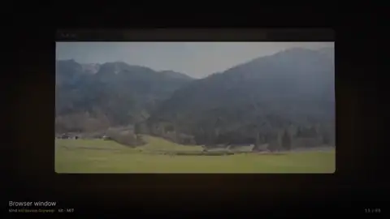
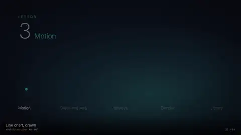

<p align="center"></p>

<p align="center">
  <b>CONNECT AI LAB</b> · AI education for everyone · 모두를 위한 AI 교육<br>
  <a href="https://www.youtube.com/@CONNECT-AI-LAB">YouTube: CONNECT AI LAB</a> · <a href="https://www.aicitybuilders.com/vibecoding">Course: Visual Vibe Coding</a> · <a href="README.ko.md">한국어</a>
</p>

# connect-ai-motion

**Your AI motion graphics employee. Turn a few lines of text into a finished motion graphics video. No footage needed.**

[](docs/index.html)

## Start

```bash
npx connect-ai-motion install-skill
```

Then open a new chat with your agent (Claude Code, Codex, Antigravity, Cursor) and say "make a motion graphics video from this script".

## Showcase

<table>
<tr>
<td width="27%" valign="top"><br><b>A course ad, no footage</b><br><sub>Ten lines of text, two screenshots. <a href="docs/demo/course_ad_9x16.mp4">mp4</a></sub></td>
<td width="27%" valign="top"><br><b>A shop promo in Korean</b><br><sub>Six lines of Korean. <a href="docs/demo/shop_ko_9x16.mp4">mp4</a></sub></td>
<td width="46%" valign="top"><br><b>A talk, without the footage</b><br><sub>My own lecture voice. <a href="docs/demo/flagship.mp4">mp4 with sound</a></sub></td>
</tr>
</table>

## One line, one scene

<table>
<tr><td width="25%" valign="top"><br><b>Flat to solid</b><br><code>kit/flat-to-solid</code></td><td width="25%" valign="top"><br><b>Your page in a browser</b><br><code>kit/device-browser</code></td><td width="25%" valign="top"><br><b>Line chart, drawn</b><br><code>kit/chart-line</code></td><td width="25%" valign="top"><br><b>Isometric city</b><br><code>kit/iso-city</code></td></tr>
<tr><td width="25%" valign="top"><br><b>Two pictures, one line</b><br><code>kit/photo-wipe</code></td><td width="25%" valign="top"><br><b>Route on a map</b><br><code>kit/draw-route</code></td><td width="25%" valign="top"><br><b>Your 3D model</b><br><code>remotion/three-model</code></td><td width="25%" valign="top"><br><b>Code and its result</b><br><code>kit/code-result</code></td></tr>
<tr><td width="25%" valign="top"><br><b>Orbit</b><br><code>kit/orbit</code></td><td width="25%" valign="top"><br><b>Word as a window</b><br><code>kit/type-mask</code></td><td width="25%" valign="top"><br><b>Donut</b><br><code>kit/chart-donut</code></td><td width="25%" valign="top"><br><b>Pixel game</b><br><code>kit/pixel-run</code></td></tr>
</table>

All <!--n-->83<!--/n--> items (66 scenes, 10 backgrounds, 7 transitions) are on the [catalog page](docs/index.html) as moving clips.

## Without an agent

```bash
npx connect-ai-motion demo          # the built-in example, start to finish
npx connect-ai-motion demo --ko     # the Korean example, 16:9 and 9:16
npx connect-ai-motion my-script.md  # your script, one line per scene
```

## Your brand

Put your own colors and font in `storyboard.json`, like this.

```json
{"colors": {"accent": "#E4572E", "bg": "#101014", "ink": "#F5F0E6"}, "font": "input/MyFont.ttf"}
```

---

Every command and option is in [docs/guide.md](docs/guide.md).

This project is MIT. It runs on [Remotion](https://www.remotion.dev), which has its own license. Remotion is free for individuals, non-profits and companies with up to 3 employees; other companies need a Remotion Company License. The details are in [NOTICE.md](NOTICE.md).

If you want to build tools like this with your own AI agent, I show you how in [Visual Vibe Coding](https://www.aicitybuilders.com/vibecoding).

<table><tr>
<td width="140" valign="top"></td>
<td valign="top"><b>Made by AI Mentor Jay</b> · CONNECT AI LAB<br>
I build AI employees like this one in the open, one by one, and show how on YouTube and in my course.<br>
<a href="https://www.youtube.com/@CONNECT-AI-LAB">YouTube</a> · <a href="https://www.aicitybuilders.com/vibecoding">Visual Vibe Coding</a> · <a href="https://github.com/wonseokjung">More open source</a></td>
</tr></table>
