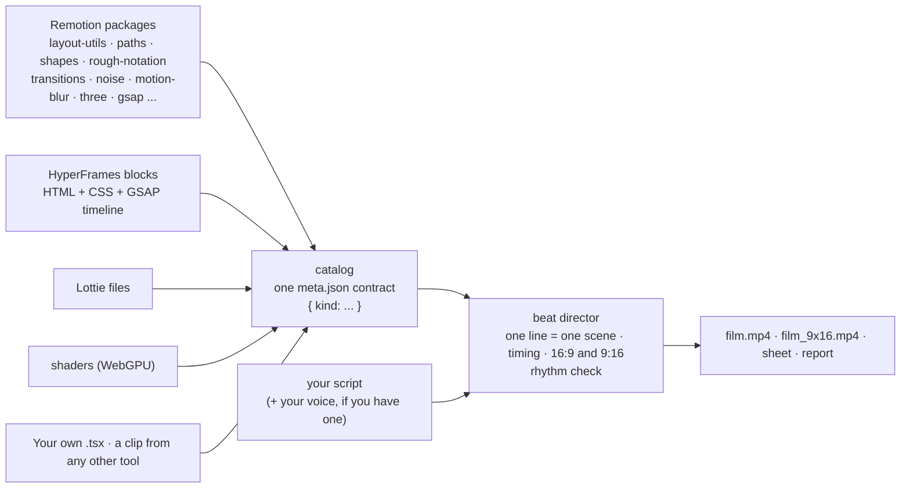
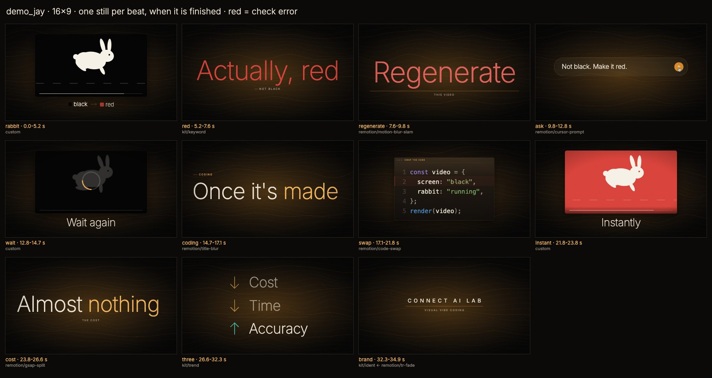

# connect-ai-motion

**No footage needed. A script becomes a finished motion-graphics film.**

Open source by [CONNECT AI LAB](https://www.youtube.com/@CONNECT-AI-LAB) · AI education for everyone · the tool of lesson 3 of the Visual Vibe Coding course.
Use it when you have something to say but nothing filmed: a channel intro, a shop promo, an explainer, a lesson recap.

One line of your script is one beat, and one beat is one full-frame scene. The scenes are not ours alone: Remotion packages, HyperFrames blocks, Lottie files, GPU shaders and your own components all sit in one catalog and are called the same way, and one layer on top directs the beats and checks the rhythm.



Like mixed martial arts took the best moves of every style and made them work in one ring, this kit does not add one more graphics library. It connects the ones that exist, so any of them is one line in `storyboard.json`:

```json
{"say": "No footage. Only a script. A finished film.", "kind": "remotion/kinetic-lines", "lines": ["No footage", "Only a script", "A finished film"]}
{"say": "Something new every three seconds.",          "kind": "hyperframes/ring-count", "value": "3", "unit": "seconds"}
{"say": "It checks itself before it renders.",         "kind": "lottie/gold-check", "text": "Check"}
{"say": "This is my own picture.",                     "kind": "custom", "component": "./scenes/Mine.tsx"}
```

> **Licences.** This kit is MIT. It runs on [Remotion](https://www.remotion.dev), which is not MIT: Remotion is free for individuals, for companies with up to 3 employees and for non-profits; other companies need a Remotion Company License ([LICENSE.md](https://github.com/remotion-dev/remotion/blob/main/LICENSE.md)). Some catalog items use Remotion packages under the same Remotion License, HyperFrames blocks are Apache-2.0, GSAP uses GreenSock's standard no-charge license (not an OSI licence). Each item says its licence in its `meta.json`; the catalog refuses anything that is not on its allow list. The full list is in [NOTICE.md](NOTICE.md).

## See it

| | File | What to look at |
|---|---|---|
| A talk, without the footage | [demo_jay.mp4](docs/demo/demo_jay.mp4) | 35 s of the author's own lecture (his voice, Korean) with no camera picture at all: 11 beats, 9 of them starting on a word he says, one custom scene (the rabbit he talks about), English on screen taken from the English subtitles of that video |
| The built-in example | [hello.mp4](docs/demo/hello.mp4) · [9:16](docs/demo/hello_9x16.mp4) | 30 s made from ten lines of text, no voice: what `demo` renders on your computer |
| Scenes | [gallery_scene.mp4](docs/demo/gallery_scene.mp4) · [sheet](docs/demo/gallery_scene_sheet.jpg) | all 35 scenes with their own example, by source |
| Backgrounds | [gallery_bg.mp4](docs/demo/gallery_bg.mp4) | 6 backgrounds (noise, rays, GPU shaders) |
| Transitions | [gallery_transition.mp4](docs/demo/gallery_transition.mp4) | 6 transitions and the light leak that passes over a hard cut |
| Catalog page | [docs/index.html](docs/index.html) | every item as a looping clip with the line that calls it |



## Try it

You need Node.js 18 or newer. No Python. The ffmpeg inside Remotion is used.

```bash
git clone https://github.com/wonseokjung/connect-ai-motion.git
cd connect-ai-motion
npm install
npx connect-ai-motion demo        # the built-in example, start to finish
npx connect-ai-motion catalog     # every scene, background and transition
```

Your own film: write a few lines in `my-script.md` and run `npx connect-ai-motion my-script.md`. Or with a coding agent (Claude Code, Codex, Antigravity): `npx connect-ai-motion install-skill`, then ask it to "make a motion graphics film from this script".

## How it works

1. **Beats.** `draft` turns each line of your script into a beat and picks a scene by what the line is: a number, steps, a contrast, a quote. It only copies words out of the line. Then you (or your agent) improve it. A line can be split into several beats, and several lines can share one.
2. **Time.** Without a voice, a beat lasts as long as its line takes to read (tier C). With your voice and subtitles next to it, a beat starts on a subtitle word (tier B, about ±0.2 s); with word times, on the word itself (tier A). Things inside a scene (list items, the moment a value changes) can land on words too.
3. **Two shapes.** The same storyboard renders in 16:9 and 9:16. Every scene has its own tall layout, and in 9:16 the words stay out of the app's top bar, button rail and caption area.
4. **Check before render.** `check` reads the storyboard like a picky editor and writes every problem as a sentence that says how to fix it.
5. **Check after render.** The kit looks at the rendered film itself and reports blank stretches, a picture that stands still, and scenes that leave the frame empty.

## What check looks for

| Rule | Grade |
|---|---|
| Nothing new on screen for more than 3 s (the picture's content, not a camera move) | error |
| The same design twice in one film | error (advice in films of 25 beats or more) |
| A word or number on screen that the script line does not say | error |
| More words than the scene reads well | error |
| On screen too short to read | error |
| A scene, background or transition that does not exist, cannot play here, or is used in the wrong place (it names the closest ones) | error |
| A missing field, a missing file | error |
| An empty picture for more than 0.6 s (measured) | error |
| Transitions on more than 40 % of the cuts, the same transition twice | advice |
| A picture that stands completely still for 1.6 s (measured) | advice |
| A scene that covers under 2 % of the frame at its fullest (measured) | advice |

"Three" in the script covers "3" on screen. If your voice is Korean and the screen is English, `say` is the English line (your subtitle translation, for example) and the words file is the Korean one: the timing follows what is spoken, the words on screen follow `say`. Whether the two mean the same is for a person to judge.

## The catalog

`npx connect-ai-motion catalog` lists everything. Today: **48 items you can play** and 3 listed with the reason they cannot (yet).

| Source | Scenes | Backgrounds, transitions | Examples |
|---|---|---|---|
| `kit/` | 10 | 1 | brand card, key word, 1 · 2 · 3 steps, before / after, up and down, quote, big number, line with stops, wall of cards, end card; light pool |
| `remotion/` | 15 | 3 + 6 + 1 | headline (layout-utils), kinetic lines, flow (paths), bars and percent ring (shapes), marked sentence (rough-notation), words in time (captions), change one line of code (prismjs), formula (KaTeX), prompt and click (mac-cursors), ask and answer (rounded-text-box), word with a trail (motion-blur), letters from the middle (gsap), stack of plates (svg-3d-engine), 3D solid (three); contour lines and breathing dots (noise), slow rays (starburst); fade, push, wipe, flip, clock wipe, iris (transitions); light leak over the cut (light-leaks) |
| `hyperframes/` | 7 | | title card, circle stat, pill stat, shape label from the warm-grain template (unchanged copies); scramble title, words rise, ring counter (our blocks in the HyperFrames format) |
| `lottie/` | 3 | | check mark, signal pulse, orbit arcs, each with a word under it |
| `shader/` | | 2 | flowing gradient, god rays (the `shaders` package, WebGPU, locked to the frame) |

Each item is a folder `catalog/<source>/<name>/` with the component (or `block.html` / `anim.json`) and a `meta.json`:

```json
{
  "kind": "remotion/rough-mark",
  "title": "Marked sentence",
  "source": {"type": "remotion", "package": "@remotion/rough-notation", "version": "4.0.529"},
  "license": "MIT",
  "role": "scene",
  "use": "emphasis",
  "props": {"text": "the sentence", "hi": "the phrase to mark", "mark": "highlight | circle | underline"},
  "needs": ["text", "hi"],
  "changes": [0, 0.4],
  "maxWords": 14,
  "family": "rough-mark",
  "example": {"text": "You only change one line", "hi": "one line"}
}
```

`role` is scene, bg, transition or sweep. `changes` tells the rhythm check when the scene itself brings something new. `family` is what "each design once" counts. `status` is `ok`, `unsupported` or `needs-download`, with `reasons`.

Listed but not playable here: the full HyperFrames registry (456 items, a download; `hf-import` then turns each block into a scene and lists the ones that cannot play frame by frame), Remocn components and remotion-bits parts (install them in your project and call them as custom scenes).

## Your own scene

A scene is a React component that receives the same props as every catalog item. Keep words inside the safe box `r`; pictures may use the whole frame.

```tsx
import React from 'react';
import {Box, SceneProps, Words, fit, k01, type} from 'connect-ai-motion/ui';

const Mine: React.FC<SceneProps> = ({it, r, lf, st, ink}) => {
  const fs = fit(String(it.text), r[2] * 0.9, r[3] * 0.4, st.weight, st.tracking);
  return (
    <Box r={r}>
      <div style={{position: 'absolute', left: 0, top: r[3] * 0.3, ...type(st, fs, ink), opacity: k01(lf, 0, 12)}}>
        <Words text={String(it.text)} lf={lf} />
      </div>
    </Box>
  );
};
export default Mine;
```

```json
{"say": "This is mine.", "kind": "custom", "component": "./scenes/Mine.tsx", "text": "Mine", "meta": {"family": "mine", "changes": [0, 0.4]}}
```

`lf` is the frame since the beat's cut, `dur` the frames until the next one, `st` the style, `u` the scale (1 = 1080 px short side), `tall` is true in 9:16. Everything must be a function of the frame: no clocks, no `Math.random()`.

The same props work for a graphic written for [connect-ai-video-motion](https://github.com/wonseokjung/connect-ai-video-motion) (lesson 2: motion graphics on top of your own talking video). Other ways in: `{"kind": "hyperframes", "src": "./block.html"}`, `{"kind": "lottie", "src": "./anim.json"}`, and `{"kind": "clip", "src": "./made-elsewhere.mp4"}` for a shot made with any other tool (Manim, Motion Canvas, Blender, a screen recording).

## Your voice

Put `voice.wav` in `<project>/input/` with `voice.srt` (or `.vtt`, or `voice.words.json` as `[{"word", "start", "end"}]`) next to it.

```json
{"id": "swap", "at": {"text": "red", "near": 20.9}, "say": "you just swap the code for black to red,",
 "kind": "remotion/code-swap", "code": "const video = {\n  screen: \"black\",\n};", "from": "black", "to": "red",
 "cues": {"swap": {"text": "red", "near": 20.9}}}
```

The film is as long as the voice. Transitions sit centred on the cuts, so adding one never moves a cut or the voice. The kit does not make word times from audio (see the roadmap); any tool that writes subtitles or word times works.

## Commands

```
npx connect-ai-motion demo                 the built-in example
npx connect-ai-motion <script.md>          your script: makes <script>-motion/ next to it and runs everything
npx connect-ai-motion new [folder]         an empty project to fill in
npx connect-ai-motion draft <script> [folder]
npx connect-ai-motion check [folder]       --short also checks 9:16, --measure also looks at out/film.mp4
npx connect-ai-motion sheet [folder]       stills only: one per beat
npx connect-ai-motion run [folder]         check, render, check the film   --short  --square  --only <beat>  --seconds 1  --force
npx connect-ai-motion preview [folder]     Remotion Studio with your storyboard
npx connect-ai-motion catalog              --use number  --role bg  --props  --json
npx connect-ai-motion gallery [folder]     the catalog itself as a film   --role scene | bg | transition  --source remotion  --sheet  --clips
npx connect-ai-motion hf-import <folder>   HyperFrames blocks to scenes
npx connect-ai-motion doctor
npx connect-ai-motion install-skill        --agent claude | codex | antigravity   (remove-skill takes it out again)
```

A project is a folder: `script.md`, `storyboard.json`, `my-info.json`, `input/` (voice, subtitles, your files), `out/` (film, sheets, `report.md`). Styles: `connect` (black and gold), `night`, `paper`; they are one block each in `src/styles/presets.mjs`.

Sound: `"sound": "tones"` adds one soft code-made tone per cut (no samples, nothing downloaded). It is off by default.

## Where it stops

- It does not film, generate footage or generate images. Every pixel is drawn by code.
- It does not write your script and it does not add claims: the screen shows words of the line, and check enforces that.
- It is not for graphics on top of a person talking: that is [connect-ai-video-motion](https://github.com/wonseokjung/connect-ai-video-motion). A beat rendered with `--only` can be cut into such a video as a full-frame insert in any editor.
- Shader backgrounds need WebGPU on the computer that renders. Without it the layer stays empty and the plain background shows.
- The first render downloads the Inter font (Google Fonts) and, once, the browser Remotion renders with.

## Roadmap

Word times from audio on your computer (whisper.cpp through `@remotion/install-whisper-cpp`, a model download you choose); cuts on the beats of a music track; importing the HyperFrames registry in one step; a stage scene that holds several lesson-2 graphics at once.

## Credits

Built on [Remotion](https://github.com/remotion-dev/remotion). HyperFrames format and template blocks by [HeyGen](https://github.com/heygen-com/hyperframes) (Apache-2.0). Timing numbers from [motionmaxxing](https://github.com/Tejashmakwana/motionmaxxing) (Apache-2.0). 9:16 app zones from [facecammaxxing](https://github.com/aaksa/facecammaxxing) (MIT). Shader presets by the [shaders](https://github.com/shader-effects-inc/shaders) package (MIT). Everything that was used, and how, is in [NOTICE.md](NOTICE.md).

---

**CONNECT AI LAB** · AI education for everyone · [YouTube](https://www.youtube.com/@CONNECT-AI-LAB) · [aicitybuilders.com](https://www.aicitybuilders.com)
Each lesson of the Visual Vibe Coding course ships one open-source tool. Lesson 2: [connect-ai-video-motion](https://github.com/wonseokjung/connect-ai-video-motion). Lesson 3: this one.

한국어: [README.ko.md](README.ko.md)
